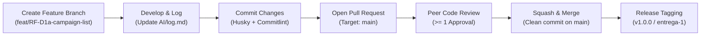

# Development Workflow & Git Governance

This directory documents the engineering workflow, version control conventions, pull request strategy, and release management for the **Mexico Dreamin Donation Portal** project.

---

## Workflow Documentation Index

- **[commits-and-linting.md](file:///Users/janssen/Documents/UADY/Semestre7/Salesforce/Proyecto/docs/workflow/commits-and-linting.md)** — Conventional Commits standard, automated Husky + Commitlint verification, and pre-commit secret guardrails (`M3`).
- **[branching-and-merge-strategy.md](file:///Users/janssen/Documents/UADY/Semestre7/Salesforce/Proyecto/docs/workflow/branching-and-merge-strategy.md)** — Feature branching model, Pull Request (PR) rules, mandatory peer review, and **Squash and Merge** to `main`.
- **[releases-and-tagging.md](file:///Users/janssen/Documents/UADY/Semestre7/Salesforce/Proyecto/docs/workflow/releases-and-tagging.md)** — Semantic Versioning (`vX.Y.Z`) and milestone deliverable tags (`entrega-1`, `entrega-2`).
- **[ai-and-documentation-logging.md](file:///Users/janssen/Documents/UADY/Semestre7/Salesforce/Proyecto/docs/workflow/ai-and-documentation-logging.md)** — Mandatory AI change logging (`AI/log.md`), deliverable AI audit trail (`docs/bitacora_ia.md`), and contribution tracking (`docs/contribucion.md`).

---

## End-to-End Developer Lifecycle

